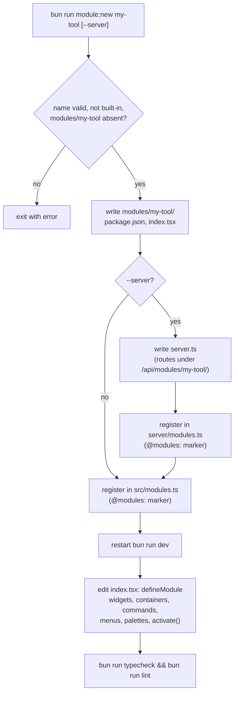

# fullstack-elysia

One Bun server for a React client and an Elysia API, with better-auth, ZenStack on Postgres, and file uploads. The client is a VS Code–style workbench that modules fill with widgets, menus, commands and palettes.

## Setup

```bash
bun install
cp .env.example .env      # set DATABASE_URL and BETTER_AUTH_SECRET
createdb fullstack_elysia
bun run db:generate
bun run db:push
bun run dev               # http://localhost:3000
```

## Scripts

| Script | What it does |
| --- | --- |
| `bun run dev` | Runs the server with hot reload |
| `bun run build` | Compiles client and server into `./run-server` |
| `bun run start` | Runs the server in production mode without compiling |
| `bun run typecheck` | Type-checks the client and server |
| `bun run db:generate` | Regenerates `zenstack/*.ts` from `schema.zmodel` |
| `bun run db:push` | Applies the schema to the database |
| `bun run module:new <name> [--server]` | Creates a module in `modules/<name>/` and registers it |

## Server flags

Pass these to `bun run dev`, `bun run start` or `./run-server`. `--help` lists them all.

| Flag | What it does |
| --- | --- |
| `-p`, `--port` | Port to listen on (default `PORT`, then 3000) |
| `-H`, `--host` | Host to listen on (default `HOST`, then `0.0.0.0`) |
| `-s`, `--ssl` | Serves HTTPS with a local mkcert certificate, created in `certs/local` if missing. Change it with `--cert`, `--key` and `--domain` |
| `--db-push` | Applies the schema to the database, then exits. Works from the compiled executable |
| `--accept-data-loss` | With `--db-push`, allows destructive schema changes |
| `--terminal` | Lets users listed in `TERMINAL_USERS` open a shell on the server from the Terminal panel. Off by default; see [Terminal](#terminal) |

## Endpoints

| Path | Purpose |
| --- | --- |
| `/healthz`, `/readyz` | Liveness, and readiness including the database |
| `/api/docs` | API reference (spec at `/api/docs/json`) |
| `/api/auth/*` | better-auth (`Auth` tag) |
| `POST /api/execute` | ORM calls under the caller's access policies (`Data` tag) |
| `POST /api/uploads`, `DELETE /api/uploads/:key` | Upload and delete your files (`Uploads` tag) |
| `POST /api/uploads/presign`, `POST /api/uploads/complete` | Direct-to-S3 upload: get a presigned URL, then confirm (`Uploads` tag) |
| `GET /api/config` | Public client settings, such as the Sentry DSN (`Config` tag) |
| `GET /api/terminal/status` | Whether you may open a terminal (`Terminal` tag) |
| `WS /api/terminal?cols=&rows=` | The terminal's shell session (`Terminal` tag) |
| `/api/modules/<id>/*` | Routes from a module's `server.ts` (`Module: <id>` tag) |
| `GET /uploads/:key` | Public read, by unguessable key |

## Uploads

Set `STORAGE_ADAPTER` to `local` (writes to `UPLOAD_DIR`) or `s3` (needs the `S3_*` variables in `.env.example`; set `S3_ENDPOINT` for services other than AWS). Files are limited by `UPLOAD_MAX_BYTES` and to PNG, JPEG, WebP, GIF, PDF and plain text.

With `s3`, `api.upload` asks for a presigned URL, PUTs the file straight to the bucket, then calls `/api/uploads/complete`, which checks the stored size. The bucket needs a CORS rule allowing `PUT` and the `Content-Type` header from your origin.

## Workbench

After sign-in the app is a workbench laid out like VS Code: an activity bar, left and right sidebars, a main area with tabs, a bottom panel and a status bar. Sizes, open parts and tabs are kept in the browser. On small screens the sidebars and panel open as sheets.

Where each widget `location` renders:

```
Workbench
|_ Title bar: menubar, search (palette)
|_ Body
|  |_ Activity bar (left containers)
|  |_ Left sidebar             location: left
|  |_ Center
|  |  |_ Main area: tabs       location: main (own URL)
|  |  |_ Bottom panel          location: bottom
|  |_ Right sidebar            location: right
|_ Status bar                  location: status (align left / right)
```

`overlay` widgets are always mounted on top of the layout and have no slot. The command palette and quick input (`workbench.quickPick`, `inputBox`) open over the title bar.

| Keys (macOS / others) | Command |
| --- | --- |
| `⇧⌘P` / `Ctrl+Shift+P`, or `F1` | Command palette |
| `⌘P` / `Ctrl+P` | Go to a page, view or open tab |
| `⌘B` / `Ctrl+B` | Toggle the left sidebar |
| `⌥⌘B` / `Ctrl+Alt+B` | Toggle the right sidebar |
| `⌘J` / `Ctrl+J` | Toggle the panel |
| `` ⌃` `` / `` Ctrl+` `` | Toggle the terminal |
| `⌥W` / `Alt+W` | Close the tab |

In the palette, `>` lists commands, no prefix searches pages and views, `?` lists every palette, and modules add their own (the Hello module's is `#`). Help › Keyboard Shortcuts lists every command and key. Browsers keep some keys for themselves (`⌘W`, `⌘T`, `⌘N`, and `⌘⇧P` in Firefox); `F1` and the search box in the title bar always work.

## Modules

Everything in the workbench comes from a module, the app's own features included (`src/features/*/module.tsx`). A new module is a package in `modules/<name>/`:

```bash
bun run module:new my-tool            # client only
bun run module:new my-tool --server   # with a server route under /api/modules/my-tool/
```

That writes `modules/my-tool/` and adds it to `src/modules.ts` (and `server/modules.ts`). Restart `bun run dev` to load it. A module's `package.json` may list its own dependencies; run `bun install` after adding them.



A module declares what it contributes with `defineModule` from `@/workbench`:

| Contribution | Use it to |
| --- | --- |
| `widgets` | Put a component in the `left` or `right` sidebar, the `bottom` panel, the `main` area (a tab with its own URL), the `status` bar, or an always-mounted `overlay` |
| `containers` | Group several widgets under one activity bar icon or panel tab |
| `commands` | Add a command, with an optional keybinding (`"mod+shift+k"`, where `mod` is ⌘ or Ctrl) |
| `menus` | Add items to the menubar (`menubar/file`, `menubar/view`, …), view and tab title bars, context menus, or a new top-level menu (`{ menu: "menubar", submenu: "my-tool.menu", title: "My Tool" }`) |
| `palettes` | Add a palette that opens when its prefix is typed |
| `activate(context)` | Register things at runtime and log to the Output panel |

At runtime, `workbench` (from `@/workbench`) runs commands, opens `quickPick` and `inputBox` prompts, shows notifications, writes Output channels, opens tabs and toggles parts of the layout. `modules/hello` uses all of it. Contribution ids must start with the module id (`my-tool.…`). Modules can be turned off per browser in the Modules view; that hides their UI, while their server routes stay mounted.

## Terminal

The Terminal panel runs a real shell on the server, as the server's OS user. It is off unless the server starts with `--terminal`, and then only users whose ids are in `TERMINAL_USERS` (comma-separated) can open one. A user who isn't listed sees their id in the panel, to send to whoever runs the server.

```bash
TERMINAL_USERS=<user-id> bun run dev --terminal
```

The socket refuses other sites' pages, API keys, and more than 5 shells per user. Shells start in `TERMINAL_CWD` (default: the server's working directory) and end when their tab or the page closes. They need a Linux or macOS server, and a proxy in front of the app must pass WebSockets through.

## Adding UI components

```bash
bunx shadcn@latest add button
```
